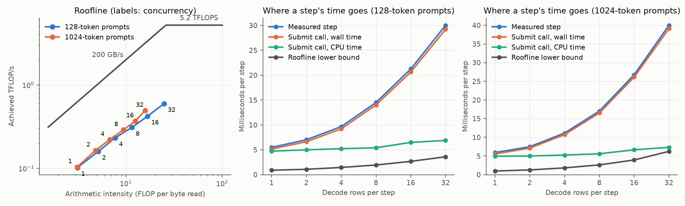

# MobileMoE-S on vLLM Metal: where does the memory bandwidth go?

An indie-track project for the Meta Global AI Developer Hackathon (Oct 26 – Nov 4, 2026).

**The question:** when vLLM serves Meta's on-device MobileMoE-S model on an Apple M1 Pro, how much of the GPU's memory bandwidth does it actually use, where does the remaining time go, and which fixes turn unused bandwidth into more tokens per second?

Each measured decode step is plotted against two limits: peak bandwidth (~200 GB/s) and peak compute (~5.2 TFLOPS). One request at a time should be limited by bandwidth. Running more requests per step reuses the weights already read, until compute becomes the limit. In a mixture-of-experts model, each extra request may also pull in different experts, so the bytes read grow too. Terms are defined in [GLOSSARY.md](GLOSSARY.md).

**Status:** the baseline is measured ([results below](#baseline-results)). vLLM serves MobileMoE-S at 12–17% of the GPU's peak memory bandwidth, and each decode step takes 6–8 times longer than the bandwidth and compute limits require. Microbenchmarks show where the time goes ([documents/findings/](documents/findings/decode-bottlenecks.md)):

- about 870 small GPU kernels per step, each with a fixed cost;
- expert weights read once per (token, expert) pair;
- attention reading each key/value head three times.

Next: fixes, in the priority order listed there.

## How Meta's models are used

- **MobileMoE-S** (open weights) is the model under study, served by vLLM through vllm-metal. The baseline serves the int4 `facebook/MobileMoE-S-QAT` ([why](docs/adr/0002-int4-qat-baseline.md)); the bfloat16 `facebook/MobileMoE-S-SFT` is used to check the port.
- **Muse Spark** (Meta Model API) reads the profiler output and the relevant engine source code and explains each bottleneck. Its explanations are saved in `analysis/findings/`.

## Layout

```
GLOSSARY.md           shared vocabulary
docs/adr/             decisions and why
third_party/          pinned submodules: vllm-metal and mlx-lm (forks, where changes go), vLLM v0.32.0 (read-only)
bench/                benchmark sweep, roofline calculation, port correctness check
bench/micro/          microbenchmarks of a decode step's parts
analysis/             map of the hot code path; Muse Spark findings
documents/benchmark/  baseline benchmark write-up: findings, every measurement, method
documents/findings/   where a decode step's time goes, and the fixes it suggests
results/runs/         every benchmark run, committed
results/traces/       Metal GPU traces (large, not committed)
```

## Setup

Requirements: Apple Silicon, macOS 15 or later, [uv](https://docs.astral.sh/uv/), and Hugging Face access to `facebook/MobileMoE-S-SFT`. Full Xcode 26.2 or later is only needed to open GPU traces and to rebuild vllm-metal's kernels.

```bash
git clone --recurse-submodules https://github.com/surucuonur/meta-hackathon.git
cd meta-hackathon
uv venv .venv --python-preference only-managed --python cpython-3.12-macos-aarch64 --seed
source .venv/bin/activate
uv pip install "https://github.com/vllm-project/vllm/releases/download/v0.32.0/vllm-0.32.0%2Bcpu-cp38-abi3-macosx_11_0_arm64.whl"
uv pip install "https://github.com/vllm-project/vllm-metal/releases/download/v0.32.0.dev20261028121433/vllm_metal-0.32.0.dev20261028121433-cp312-cp312-macosx_15_0_arm64.whl"
uv pip install --no-deps -e third_party/mlx-lm
uv pip install -e bench/steplog matplotlib
```

Python must be native arm64. An Intel Python running under Rosetta can't install these wheels, so `--python` forces uv's own arm64 build. The vllm-metal wheel is the prebuilt release of the commit pinned in `third_party/vllm-metal`. The editable `mlx-lm` install is the fork where the MobileMoE port lives.

vllm-metal's own tools (for example `tools/check_parity.py`) import the submodule's source, which has no compiled kernels until it is built with Xcode. Until then, copy them from the wheel (same commit; the files are git-ignored in the submodule):

```bash
W=.venv/lib/python3.12/site-packages/vllm_metal
for f in $(cd $W && ls metal/*.metallib metal/_paged_ops.* pytorch_backend/_mps_ops.*so pytorch_backend/_mps_ops.torch-version); do
  cp "$W/$f" "third_party/vllm-metal/vllm_metal/$f"
done
```

`.env` is not committed. It holds `MODEL_API_KEY` for Muse Spark and `HUGGINGFACE_API_KEY` for downloading the gated model; the scripts pass the second one to Hugging Face tools as `HF_TOKEN`.

The int4 model is converted to MLX's format once. The serving copy has bfloat16 scales; the float32 copy keeps the scales exact for the correctness check. Both go to `models/` (git-ignored):

```bash
.venv/bin/python bench/convert_qat.py                   # needs HF_TOKEN for the first download
.venv/bin/python bench/convert_qat.py --dtype float32
```

### Port check

No inference engine supported MobileMoE, so it is ported to mlx_lm (`third_party/mlx-lm/mlx_lm/models/mobilemoe.py`). `bench/check_port.py` compares the port with Meta's PyTorch code on fixed prompts. Meta's code needs transformers 4.57 and mlx-lm needs 5.7 or newer, so the reference runs in a second environment:

```bash
uv venv .venv-ref --python-preference only-managed --python cpython-3.12-macos-aarch64 --seed
uv pip install --python .venv-ref/bin/python torch "transformers==4.57.6" numpy jinja2 safetensors
for dtype in float32 bfloat16; do
  .venv-ref/bin/python bench/check_port.py ref --dtype $dtype
  .venv/bin/python bench/check_port.py mlx --dtype $dtype
done
```

float32 is the correctness gate: same greedy tokens, same top-1 token at every position, and logits within 0.01. bfloat16 is a sanity gate: the port's error against the exact answer must stay within 1.5x of the reference's own bfloat16 error. Summaries go to `results/port/`. For the int4 model, the same steps run with `--model facebook/MobileMoE-S-QAT` and the converted copies (commands in `bench/check_port.py`).

| Model | float32 gate | bfloat16 gate (worst error ratio) |
|---|---|---|
| MobileMoE-S-SFT | PASS, logits within 0.0001 | PASS (1.18) |
| MobileMoE-S-QAT (int4) | PASS, logits within 0.0001 | PASS (1.43; the bfloat16 scales round each group of 32 weights together) |

A second check confirms that serving through vLLM gives the same tokens as plain mlx_lm, because vllm-metal runs its own attention code instead of the port's: 0 failures in 80 requests for both models ([SFT](results/port/MobileMoE-S-SFT-serving-parity.md), [QAT](results/port/MobileMoE-S-QAT-serving-parity.md)).

## Baseline results

The unmodified engine (vLLM 0.32.0, vllm-metal 0.32.0.dev20261028121433, mlx 0.32.4) serving MobileMoE-S-QAT on an M1 Pro (16-core GPU, 16 GB, macOS 15.7.4, on AC power). Random-token prompts of 128 or 1,024 tokens, 256 generated tokens each, 1 to 32 requests in flight. Every point ran 3 times in shuffled order. All files are in [results/runs/2026-10-29-baseline/](results/runs/2026-10-29-baseline/), with the [full table](results/runs/2026-10-29-baseline/summary.md). The full write-up, with every measurement and how it was made, is in [documents/benchmark/](documents/benchmark/).



Steady decode steps only (no prompt tokens in the step). "MB read" is what the step must read: the weights of the experts its rows use, the rest of the weights, and the rows' attention cache. "Lower bound" is the step time at peak bandwidth or peak compute, whichever is slower.

| Prompt | Requests | Step ms | Decode tok/s | Distinct experts / layer | MB read | GB/s (% of peak) | CPU ms in step submit | Lower bound ms |
|---:|---:|---:|---:|---:|---:|---:|---:|---:|
| 128 | 1 | 5.5 | 182 | 4.0 | 179 | 32.6 (16%) | 4.7 | 0.9 |
| 128 | 4 | 9.7 | 414 | 12.6 | 290 | 30.0 (15%) | 5.2 | 1.5 |
| 128 | 16 | 21.3 | 753 | 29.1 | 535 | 25.2 (13%) | 6.5 | 2.7 |
| 128 | 32 | 30.0 | 1,065 | 38.2 | 720 | 24.0 (12%) | 6.9 | 3.6 |
| 1024 | 1 | 5.9 | 169 | 4.0 | 197 | 33.3 (17%) | 5.0 | 1.0 |
| 1024 | 32 | 40.0 | 800 | 32.9 | 1,248 | 31.2 (16%) | 7.3 | 6.2 |

What the data shows:

- **No step is bandwidth-bound or compute-bound.** Achieved bandwidth stays at 24–34 GB/s for every setting, and each step takes 6–8 times its lower bound. In the terms of [GLOSSARY.md](GLOSSARY.md), the baseline is overhead-bound everywhere.
- **Batching helps, but each extra request costs a lot.** With 128-token prompts, 32 requests give 5.9 times the tokens per second of one request. The step grows by about 0.8 ms per request, while the bytes it must read grow by about 17 MB per request, which takes 0.09 ms at peak bandwidth.
- **With one request, the CPU and the GPU are both near their limit.** vllm-metal's step-submit call uses 4.7 ms of CPU time in a 5.5 ms step, so even a perfect GPU would leave the step near 5 ms.
- **With more requests, the GPU work sets the pace.** The CPU time grows only to 7 ms at 32 requests. The rest of the submit call is waiting, and macOS reports the GPU busy for 90–100% of every run. The GPU has work queued almost all the time, but that work moves only about 30 GB/s.

Where the time goes, from microbenchmarks run after the sweep ([documents/findings/decode-bottlenecks.md](documents/findings/decode-bottlenecks.md)):

- **Kernel count.** vLLM itself adds only 5–10%. Each step is about 870 small GPU kernels with a fixed cost each.
- **Expert reads.** MLX reads each expert's weights once per (token, expert) pair, because it picks its grouped kernel only from 60 rows per step.
- **Attention.** vllm-metal's grouped-query attention kernel doesn't support MobileMoE-S's 12/4 head layout, so the keys and values are read three times.

The weight layout of Meta's experts is not the main cause.

Limits of these numbers:

- **Swapping:** the Mac swapped out 0–7,567 pages/s during runs (322 pages/s idle). One run (128-token prompts, 16 requests) was 7% slower than its repeats during the heaviest swapping; the medians above are robust to it.
- **Bytes:** activations are not counted, and the GPU-busy figure is macOS's device-wide counter, which says the GPU had work, not how efficiently it ran.
- **Prompts:** they are random tokens. Expert routing on real text may pick different numbers of distinct experts.

Reproduce (about 35 minutes):

```bash
.venv/bin/python bench/sweep.py --label baseline
.venv/bin/python bench/roofline.py results/runs/<date>-baseline
```

`bench/steplog` is a vLLM plugin that records every engine step (requests advanced, prompt tokens, context read, time in the step-submit call); `bench/sweep.py` runs the grid against a real `vllm serve`, then repeats it once with distinct-expert counting on; `bench/roofline.py` turns the logs into the table and chart.
