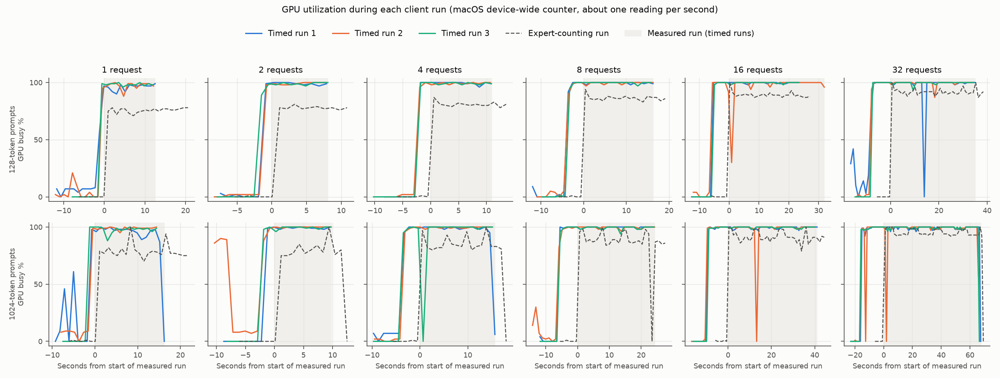

# Measurements from the baseline benchmark

Every number from the 2026-10-29 sweep. vLLM 0.32.0 with vllm-metal 0.32.0.dev20261028121433 served MobileMoE-S-QAT (int4) on an M1 Pro (16-core GPU, 16 GB). How each number is produced is in [method.md](method.md); what the numbers show is in [findings.md](findings.md).

The tables are generated from [results/runs/2026-10-29-baseline/](../../results/runs/2026-10-29-baseline/):

```bash
.venv/bin/python bench/roofline.py results/runs/2026-10-29-baseline    # main table, roofline.json, chart
.venv/bin/python bench/run_tables.py results/runs/2026-10-29-baseline  # every other table here
```

How to read the tables:

- **Prompt:** prompt length in tokens.
- **Requests:** the client's concurrency. In the steady steps used here, it equals the decode rows.
- **Step ms:** the median time from the start of one steady decode step to the start of the next, pooled over the three repeats.
- **Lower bound ms:** the step time at peak bandwidth (200 GB/s) or peak compute (5.2 TFLOPS), whichever is slower.
- **Submit call:** vllm-metal's `_start_paged_forward`, which prepares a step and queues its GPU work. "CPU" is the CPU time of the thread inside the call; "waiting" is the rest of its wall time.

## Main table

This is `summary.md` from the run folder, where "Input" is the prompt length and "Concurrency" the number of requests. Steady decode steps only. The step-time range is the spread of the three repeats' medians.

| Input | Concurrency | Steps | Step ms (run range) | Submit call ms | Submit CPU ms | Decode tok/s | Distinct experts / layer | MB read / step | GB/s | % of peak | FLOP/byte | Min ms at peak |
|---:|---:|---:|---|---:|---:|---:|---:|---:|---:|---:|---:|---:|
| 128 | 1 | 6072 | 5.49 (5.44–5.51) | 5.16 | 4.73 | 182 | 4.0 | 179 | 32.6 | 16.3 | 3.14 | 0.89 |
| 128 | 2 | 3024 | 7.02 (6.93–7.16) | 6.64 | 4.99 | 285 | 7.0 | 217 | 30.9 | 15.4 | 5.17 | 1.08 |
| 128 | 4 | 3024 | 9.66 (9.62–9.70) | 9.22 | 5.23 | 414 | 12.6 | 290 | 30.0 | 15.0 | 7.74 | 1.45 |
| 128 | 8 | 3023 | 14.51 (14.30–14.71) | 14.03 | 5.41 | 551 | 19.6 | 388 | 26.8 | 13.4 | 11.55 | 1.94 |
| 128 | 16 | 3017 | 21.26 (20.82–22.28) | 20.65 | 6.49 | 753 | 29.1 | 535 | 25.2 | 12.6 | 16.76 | 2.68 |
| 128 | 32 | 3008 | 30.04 (29.90–30.23) | 29.23 | 6.89 | 1065 | 38.2 | 720 | 24.0 | 12.0 | 24.93 | 3.60 |
| 1024 | 1 | 6072 | 5.92 (5.88–6.02) | 5.56 | 4.96 | 169 | 4.0 | 197 | 33.3 | 16.6 | 3.12 | 0.99 |
| 1024 | 2 | 3024 | 7.49 (7.44–7.55) | 7.11 | 5.00 | 267 | 7.1 | 254 | 34.0 | 17.0 | 4.84 | 1.27 |
| 1024 | 4 | 3011 | 11.15 (11.10–11.36) | 10.73 | 5.26 | 359 | 12.6 | 363 | 32.6 | 16.3 | 6.78 | 1.82 |
| 1024 | 8 | 2984 | 17.03 (17.00–17.06) | 16.54 | 5.60 | 470 | 18.6 | 523 | 30.7 | 15.4 | 9.41 | 2.62 |
| 1024 | 16 | 2935 | 26.76 (26.75–26.78) | 26.14 | 6.66 | 598 | 25.4 | 788 | 29.4 | 14.7 | 12.50 | 3.94 |
| 1024 | 32 | 2834 | 39.99 (39.58–40.49) | 39.13 | 7.33 | 800 | 32.9 | 1248 | 31.2 | 15.6 | 15.79 | 6.24 |

Swap-outs during runs: 0–7567 pages/s (idle before the sweep: 322 pages/s).

## Bytes and time per decode step

The bytes each step must read, by source:

- **Every-step weights:** attention, shared expert, router and norms of all 20 layers.
- **Output layer:** the tied embedding matrix that scores the vocabulary.
- **Experts:** distinct experts per layer × 20 layers × 0.55 MB.
- **Cache:** the attention cache of every row's context, plus its new token.

The step's time is split between the submit call's CPU work and its waiting. The few kilobytes of embedding rows are in the total but have no column.

| Prompt | Requests | Every-step weights MB | Output layer MB | Experts MB | Cache MB | Total MB | Step ms | Submit call ms | Submit CPU ms | Submit waiting ms | Lower bound ms | Step / lower bound |
|---|---:|---:|---:|---:|---:|---:|---:|---:|---:|---:|---:|---:|
| 128 | 1 | 67.6 | 61.6 | 44.2 | 5.3 | 178.7 | 5.49 | 5.16 | 4.73 | 0.43 | 0.89 | 6.1 |
| 128 | 2 | 67.6 | 61.6 | 77.2 | 10.5 | 217.0 | 7.02 | 6.64 | 4.99 | 1.64 | 1.08 | 6.5 |
| 128 | 4 | 67.6 | 61.6 | 139.6 | 21.0 | 289.9 | 9.66 | 9.22 | 5.23 | 3.99 | 1.45 | 6.7 |
| 128 | 8 | 67.6 | 61.6 | 217.1 | 42.0 | 388.4 | 14.51 | 14.03 | 5.41 | 8.61 | 1.94 | 7.5 |
| 128 | 16 | 67.6 | 61.6 | 321.9 | 84.1 | 535.2 | 21.26 | 20.65 | 6.49 | 14.17 | 2.68 | 7.9 |
| 128 | 32 | 67.6 | 61.6 | 422.2 | 168.2 | 719.6 | 30.04 | 29.23 | 6.89 | 22.34 | 3.60 | 8.3 |
| 1024 | 1 | 67.6 | 61.6 | 44.2 | 23.6 | 197.1 | 5.92 | 5.56 | 4.96 | 0.60 | 0.99 | 6.0 |
| 1024 | 2 | 67.6 | 61.6 | 78.0 | 47.2 | 254.4 | 7.49 | 7.11 | 5.00 | 2.12 | 1.27 | 5.9 |
| 1024 | 4 | 67.6 | 61.6 | 139.5 | 94.4 | 363.2 | 11.15 | 10.73 | 5.26 | 5.46 | 1.82 | 6.1 |
| 1024 | 8 | 67.6 | 61.6 | 205.3 | 188.9 | 523.4 | 17.03 | 16.54 | 5.60 | 10.94 | 2.62 | 6.5 |
| 1024 | 16 | 67.6 | 61.6 | 280.9 | 377.7 | 787.8 | 26.76 | 26.14 | 6.66 | 19.47 | 3.94 | 6.8 |
| 1024 | 32 | 67.6 | 61.6 | 363.3 | 755.2 | 1247.8 | 39.99 | 39.13 | 7.33 | 31.81 | 6.24 | 6.4 |

## Cost of each added request

Between neighbouring settings: the step time each added request costs, against the time its added bytes would take at peak bandwidth. The ratio column divides the first by the second.

| Prompt | Requests | Step ms per added request | Submit CPU ms per added request | MB per added request | Ms at peak bandwidth | Ratio |
|---|---:|---:|---:|---:|---:|---:|
| 128 | 1 to 2 | 1.54 | 0.26 | 38.3 | 0.19 | 8.0 |
| 128 | 2 to 4 | 1.32 | 0.12 | 36.4 | 0.18 | 7.2 |
| 128 | 4 to 8 | 1.21 | 0.05 | 24.6 | 0.12 | 9.8 |
| 128 | 8 to 16 | 0.84 | 0.13 | 18.4 | 0.09 | 9.2 |
| 128 | 16 to 32 | 0.55 | 0.03 | 11.5 | 0.06 | 9.5 |
| 1024 | 1 to 2 | 1.57 | 0.04 | 57.4 | 0.29 | 5.5 |
| 1024 | 2 to 4 | 1.83 | 0.13 | 54.4 | 0.27 | 6.7 |
| 1024 | 4 to 8 | 1.47 | 0.08 | 40.1 | 0.20 | 7.3 |
| 1024 | 8 to 16 | 1.22 | 0.13 | 33.1 | 0.17 | 7.4 |
| 1024 | 16 to 32 | 0.83 | 0.04 | 28.7 | 0.14 | 5.8 |

## Client view and compute rate

- **Client tok/s:** what `vllm bench serve` reports, generated tokens over the whole measured run, including prompt steps, ramp-up and drain.
- **Engine decode tok/s:** requests divided by the steady step time.
- **ITL and TTFT:** time between tokens and time to first token, as the median of the three runs' medians.
- **Achieved TFLOPS:** the step's operations divided by its time.

| Prompt | Requests | Client tok/s | Engine decode tok/s | Median ITL ms | Median TTFT ms | Step ms p95 | Achieved TFLOPS | FLOP/byte |
|---|---:|---:|---:|---:|---:|---:|---:|---:|
| 128 | 1 | 173 | 182 | 5.48 | 53 | 6.40 | 0.10 | 3.1 |
| 128 | 2 | 271 | 285 | 6.97 | 94 | 7.66 | 0.16 | 5.2 |
| 128 | 4 | 390 | 414 | 9.65 | 143 | 10.31 | 0.23 | 7.7 |
| 128 | 8 | 518 | 551 | 14.42 | 236 | 15.40 | 0.31 | 11.5 |
| 128 | 16 | 710 | 753 | 20.99 | 417 | 37.82 | 0.42 | 16.8 |
| 128 | 32 | 967 | 1065 | 30.04 | 774 | 31.49 | 0.60 | 24.9 |
| 1024 | 1 | 145 | 169 | 5.95 | 222 | 7.49 | 0.10 | 3.1 |
| 1024 | 2 | 217 | 267 | 7.54 | 429 | 8.15 | 0.16 | 4.8 |
| 1024 | 4 | 276 | 359 | 11.16 | 819 | 12.01 | 0.22 | 6.8 |
| 1024 | 8 | 345 | 470 | 17.04 | 1166 | 17.41 | 0.29 | 9.4 |
| 1024 | 16 | 412 | 598 | 26.76 | 1203 | 27.71 | 0.37 | 12.5 |
| 1024 | 32 | 501 | 800 | 39.70 | 1461 | 41.96 | 0.49 | 15.8 |

## Distinct experts, and the cost of counting them

Counted in a separate pass of the grid, one run per setting, because counting slows every step: it forces the step's GPU work to finish so the router's choices can be read.

The means here use steady steps whose neighbours are steady too. The roofline uses every decode-only step with all rows present, so its means differ by up to 0.1.

| Prompt | Requests | Step ms (timed) | Step ms (counting) | Added | Distinct experts / layer, mean | Min | Max |
|---|---:|---:|---:|---:|---:|---:|---:|
| 128 | 1 | 5.49 | 9.63 | +4.15 | 4.0 | 4 | 4 |
| 128 | 2 | 7.02 | 9.87 | +2.84 | 7.0 | 4 | 8 |
| 128 | 4 | 9.66 | 12.17 | +2.50 | 12.6 | 6 | 16 |
| 128 | 8 | 14.51 | 17.34 | +2.82 | 19.6 | 10 | 30 |
| 128 | 16 | 21.26 | 24.60 | +3.34 | 29.1 | 16 | 44 |
| 128 | 32 | 30.04 | 33.98 | +3.94 | 38.2 | 22 | 54 |
| 1024 | 1 | 5.92 | 9.64 | +3.72 | 4.0 | 4 | 4 |
| 1024 | 2 | 7.49 | 9.98 | +2.49 | 7.1 | 4 | 8 |
| 1024 | 4 | 11.15 | 13.80 | +2.65 | 12.6 | 7 | 16 |
| 1024 | 8 | 17.03 | 20.26 | +3.23 | 18.6 | 10 | 30 |
| 1024 | 16 | 26.76 | 30.59 | +3.83 | 25.4 | 14 | 39 |
| 1024 | 32 | 39.99 | 43.75 | +3.76 | 32.8 | 20 | 50 |

## Steps with prompt tokens

Steps in the timed runs that carry at least 1,000 prompt tokens. "Prompt TFLOPS" counts only the weight multiplications for the prompt tokens (2 × the weights each token uses). It leaves out attention and the decode rows sharing the step, so it understates the rate a little. The step time includes whatever the engine overlapped with the step. No 128-token run has a prompt-only step this large.

| Prompt | Step | Steps | Prompt tokens (median) | Decode rows (median) | Step ms | Submit CPU ms | Prompt TFLOPS (weights only) |
|---|---:|---:|---:|---:|---:|---:|---:|
| 128 | with decode rows | 36 | 1920.0 | 3.0 | 350 | 53 | 2.99 |
| 1024 | prompt only | 60 | 1024.0 | 0.0 | 204 | 21 | 2.73 |
| 1024 | with decode rows | 399 | 2023 | 12 | 397 | 30 | 2.71 |

## Repeats

Each setting ran three times, in a shuffled order (the "Order" column of the next table). "Largest gap" is the furthest a repeat's median lies from the setting's median.

| Prompt | Requests | Step ms (all steady steps) | Step ms per repeat (r0, r1, r2) | Largest gap % | Swap-outs/s per repeat |
|---|---:|---:|---:|---:|---:|
| 128 | 1 | 5.49 | 5.51, 5.51, 5.44 | 0.8 | 6811, 7279, 0 |
| 128 | 2 | 7.02 | 6.93, 6.97, 7.16 | 2.0 | 209, 0, 1721 |
| 128 | 4 | 9.66 | 9.70, 9.62, 9.67 | 0.5 | 751, 618, 1194 |
| 128 | 8 | 14.51 | 14.44, 14.71, 14.30 | 1.5 | 5504, 535, 0 |
| 128 | 16 | 21.26 | 20.82, 22.28, 21.00 | 4.8 | 2079, 7567, 581 |
| 128 | 32 | 30.04 | 30.23, 29.90, 30.08 | 0.6 | 4673, 711, 865 |
| 1024 | 1 | 5.92 | 6.02, 5.88, 5.93 | 1.8 | 5089, 1582, 763 |
| 1024 | 2 | 7.49 | 7.44, 7.48, 7.55 | 0.9 | 1188, 4847, 963 |
| 1024 | 4 | 11.15 | 11.36, 11.10, 11.16 | 1.9 | 2760, 388, 1574 |
| 1024 | 8 | 17.03 | 17.04, 17.06, 17.00 | 0.2 | 1054, 3130, 300 |
| 1024 | 16 | 26.76 | 26.76, 26.75, 26.78 | 0.0 | 2916, 639, 675 |
| 1024 | 32 | 39.99 | 39.58, 39.75, 40.49 | 1.3 | 3339, 948, 888 |

## Every run

All 48 client runs: 36 timed (three per setting) and 12 expert-counting runs.

- **Expert-counting runs:** their step times are slowed by the counting, so don't compare them with the timed runs.
- **Order:** the run's position in the sweep, which took 30 minutes.
- **GPU busy:** macOS's device-wide utilization, read about once per second. The readings have no timestamps, so their times are estimated ([method.md](method.md)); the columns use the readings that fall inside the measured window. The next section shows the readings over time.
- **Swap-outs/s:** measured from just before the client starts until just after it ends.

| Run | Order | Client tok/s | Median ITL ms | p99 ITL ms | Median TTFT ms | Steady steps | Step ms | Step ms p95 | Submit CPU ms | GPU busy % (mean / median) | Swap-outs/s | Free memory % before |
|---|---:|---:|---:|---:|---:|---:|---:|---:|---:|---:|---:|---:|
| timed-in128-c1-r0 | 3 | 168.2 | 5.48 | 10.86 | 57 | 2024 | 5.51 | 6.93 | 4.79 | 96 / 97 | 6811 | 25 |
| timed-in128-c1-r1 | 24 | 173.2 | 5.51 | 7.82 | 53 | 2024 | 5.51 | 6.28 | 4.69 | 97 / 99 | 7279 | 29 |
| timed-in128-c1-r2 | 28 | 176.4 | 5.43 | 7.24 | 52 | 2024 | 5.44 | 5.98 | 4.71 | 98 / 98 | 0 | 32 |
| timed-in128-c2-r0 | 10 | 271.4 | 6.92 | 10.63 | 94 | 1008 | 6.93 | 7.63 | 4.99 | 99 / 99 | 209 | 33 |
| timed-in128-c2-r1 | 23 | 272.2 | 6.97 | 8.95 | 94 | 1008 | 6.97 | 7.68 | 4.97 | 99 / 100 | 0 | 33 |
| timed-in128-c2-r2 | 25 | 263.7 | 7.14 | 10.66 | 96 | 1008 | 7.16 | 7.63 | 5.05 | 99 / 100 | 1721 | 30 |
| timed-in128-c4-r0 | 12 | 389.4 | 9.69 | 14.52 | 143 | 1008 | 9.70 | 10.43 | 5.13 | 99 / 100 | 751 | 34 |
| timed-in128-c4-r1 | 20 | 393.4 | 9.61 | 12.17 | 141 | 1008 | 9.62 | 10.29 | 5.10 | 99 / 99 | 618 | 33 |
| timed-in128-c4-r2 | 33 | 390.5 | 9.65 | 14.74 | 150 | 1008 | 9.67 | 10.29 | 5.43 | 99 / 99 | 1194 | 33 |
| timed-in128-c8-r0 | 7 | 517.8 | 14.42 | 23.53 | 250 | 1007 | 14.44 | 15.37 | 6.09 | 100 / 100 | 5504 | 24 |
| timed-in128-c8-r1 | 15 | 514.0 | 14.72 | 16.35 | 230 | 1008 | 14.71 | 15.62 | 5.07 | 100 / 100 | 535 | 30 |
| timed-in128-c8-r2 | 36 | 525.0 | 14.37 | 16.63 | 236 | 1008 | 14.30 | 14.73 | 5.41 | 100 / 100 | 0 | 38 |
| timed-in128-c16-r0 | 9 | 714.2 | 20.88 | 24.69 | 407 | 1008 | 20.82 | 21.62 | 6.33 | 100 / 100 | 2079 | 27 |
| timed-in128-c16-r1 | 16 | 536.3 | 23.04 | 48.62 | 516 | 1004 | 22.28 | 40.90 | 7.24 | 97 / 100 | 7567 | 39 |
| timed-in128-c16-r2 | 31 | 709.7 | 20.99 | 24.75 | 417 | 1005 | 21.00 | 21.79 | 6.19 | 100 / 100 | 581 | 33 |
| timed-in128-c32-r0 | 5 | 960.1 | 30.04 | 42.22 | 794 | 1004 | 30.23 | 31.77 | 7.95 | 97 / 100 | 4673 | 27 |
| timed-in128-c32-r1 | 21 | 972.2 | 29.87 | 32.96 | 772 | 1002 | 29.90 | 31.24 | 6.60 | 99 / 100 | 711 | 30 |
| timed-in128-c32-r2 | 32 | 967.5 | 30.15 | 33.60 | 774 | 1002 | 30.08 | 31.46 | 6.68 | 100 / 100 | 865 | 31 |
| timed-in1024-c1-r0 | 6 | 136.7 | 6.01 | 13.18 | 237 | 2024 | 6.02 | 8.29 | 5.43 | 90 / 97 | 5089 | 28 |
| timed-in1024-c1-r1 | 18 | 146.0 | 5.91 | 7.96 | 222 | 2024 | 5.88 | 6.75 | 4.81 | 99 / 99 | 1582 | 30 |
| timed-in1024-c1-r2 | 29 | 145.0 | 5.95 | 9.06 | 219 | 2024 | 5.93 | 6.81 | 4.90 | 98 / 98 | 763 | 33 |
| timed-in1024-c2-r0 | 1 | 220.9 | 7.43 | 9.04 | 423 | 1008 | 7.44 | 7.62 | 4.92 | 99 / 99 | 1188 | 30 |
| timed-in1024-c2-r1 | 17 | 214.7 | 7.54 | 9.34 | 437 | 1008 | 7.48 | 8.26 | 5.01 | 100 / 100 | 4847 | 26 |
| timed-in1024-c2-r2 | 26 | 216.8 | 7.56 | 9.07 | 429 | 1008 | 7.55 | 7.92 | 5.03 | 99 / 100 | 963 | 29 |
| timed-in1024-c4-r0 | 4 | 270.4 | 11.33 | 22.66 | 840 | 1004 | 11.36 | 12.16 | 5.19 | 93 / 100 | 2760 | 26 |
| timed-in1024-c4-r1 | 19 | 279.9 | 11.11 | 12.49 | 819 | 1004 | 11.10 | 11.82 | 5.23 | 100 / 100 | 388 | 34 |
| timed-in1024-c4-r2 | 34 | 276.2 | 11.16 | 20.46 | 819 | 1003 | 11.16 | 11.70 | 5.40 | 93 / 100 | 1574 | 33 |
| timed-in1024-c8-r0 | 11 | 345.1 | 17.04 | 26.55 | 1001 | 994 | 17.04 | 17.38 | 5.53 | 100 / 100 | 1054 | 28 |
| timed-in1024-c8-r1 | 13 | 344.5 | 17.04 | 21.65 | 1400 | 996 | 17.06 | 17.57 | 5.58 | 100 / 100 | 3130 | 29 |
| timed-in1024-c8-r2 | 35 | 345.2 | 17.00 | 25.51 | 1166 | 994 | 17.00 | 17.37 | 5.72 | 99 / 100 | 300 | 32 |
| timed-in1024-c16-r0 | 8 | 410.6 | 26.76 | 394.37 | 1203 | 978 | 26.76 | 27.95 | 7.61 | 99 / 100 | 2916 | 32 |
| timed-in1024-c16-r1 | 22 | 412.2 | 26.72 | 396.03 | 1242 | 979 | 26.75 | 27.70 | 6.45 | 97 / 100 | 639 | 31 |
| timed-in1024-c16-r2 | 27 | 411.7 | 26.80 | 396.90 | 1197 | 978 | 26.78 | 27.60 | 6.53 | 100 / 100 | 675 | 32 |
| timed-in1024-c32-r0 | 2 | 501.7 | 39.48 | 413.15 | 1652 | 946 | 39.58 | 41.22 | 8.16 | 98 / 100 | 3339 | 33 |
| timed-in1024-c32-r1 | 14 | 500.9 | 39.70 | 409.98 | 1460 | 944 | 39.75 | 41.32 | 7.16 | 97 / 100 | 948 | 30 |
| timed-in1024-c32-r2 | 30 | 495.4 | 40.55 | 408.12 | 1461 | 944 | 40.49 | 42.28 | 7.04 | 98 / 100 | 888 | 28 |
| experts-in128-c1-r0 | 39 | 100.6 | 9.61 | 14.84 | 63 | 2024 | 9.63 | 11.46 | 4.49 | 76 / 76 | 2935 | 30 |
| experts-in128-c2-r0 | 46 | 193.6 | 9.88 | 11.97 | 101 | 1008 | 9.87 | 10.88 | 4.65 | 71 / 78 | 0 | 38 |
| experts-in128-c4-r0 | 48 | 309.6 | 12.16 | 15.50 | 153 | 1008 | 12.17 | 13.20 | 4.73 | 81 / 81 | 0 | 34 |
| experts-in128-c8-r0 | 43 | 436.0 | 17.26 | 20.06 | 252 | 1008 | 17.34 | 18.57 | 4.99 | 86 / 86 | 548 | 30 |
| experts-in128-c16-r0 | 45 | 609.6 | 24.57 | 27.36 | 431 | 1008 | 24.60 | 26.17 | 5.90 | 89 / 89 | 309 | 31 |
| experts-in128-c32-r0 | 41 | 860.2 | 33.95 | 43.09 | 756 | 1001 | 33.98 | 37.64 | 6.29 | 92 / 92 | 909 | 30 |
| experts-in1024-c1-r0 | 42 | 95.4 | 9.60 | 12.82 | 227 | 2024 | 9.64 | 11.08 | 4.60 | 75 / 77 | 678 | 40 |
| experts-in1024-c2-r0 | 37 | 169.0 | 9.98 | 12.66 | 427 | 1008 | 9.98 | 11.01 | 4.72 | 68 / 77 | 1657 | 26 |
| experts-in1024-c4-r0 | 40 | 231.2 | 13.83 | 18.83 | 825 | 1003 | 13.80 | 15.18 | 5.01 | 81 / 83 | 1469 | 33 |
| experts-in1024-c8-r0 | 47 | 300.5 | 20.24 | 32.64 | 1002 | 993 | 20.26 | 21.52 | 5.32 | 86 / 88 | 0 | 38 |
| experts-in1024-c16-r0 | 44 | 371.6 | 30.56 | 394.99 | 1253 | 979 | 30.59 | 33.97 | 6.30 | 91 / 91 | 1411 | 31 |
| experts-in1024-c32-r0 | 38 | 475.2 | 43.72 | 406.04 | 1439 | 944 | 43.75 | 45.36 | 6.55 | 93 / 94 | 693 | 31 |

GPU samples in the timed windows: 816, 9 below 50%.

## GPU utilization over time



One panel per setting, one line per client run: the three timed runs in colour and the expert-counting run dashed. Time 0 is the start of the measured run. The shaded band covers the measured run of the timed runs; where their lengths differ, it covers the longest. The readings have no timestamps, so their times are estimates, good to about a second. Every reading is in the "Every run" table's source, `runs.json`, and the chart is drawn by `bench/gpu_chart.py`.

What it shows:

- **Before time 0**, the client starts up, with the GPU near 0%. It then sends its warmup requests, which already keep the GPU busy, for a few seconds at short prompts and up to about 15 s at 1,024-token prompts with 32 requests. The expert-counting runs send no warmup, so their GPU use starts at time 0.
- **During the measured run**, the timed runs read 97–100% in almost every second, at every setting, including a single request.
- **The expert-counting runs sit lower**, at 68–93% on average. Counting makes every layer wait for the GPU so the CPU can read the router's choices, and the GPU idles while it does. These runs give a visible example of what a CPU–GPU round trip in every layer costs.

Readings that don't fit the pattern:

- **Nine readings inside the timed windows fall below 50%.**
  - Four are the last reading of a run, in the final second before the client exited, when its requests had most likely all finished.
  - Three come in the first 2 seconds of a measured run, as the client moves from warmup to the main requests.
  - Two sit in the middle of a run, each a single reading of 0% between readings of 97–100% (at about 14 s with 128-token prompts and 32 requests, run 1, and at about 13 s with 1,024-token prompts and 16 requests, run 2).

  At one reading per second, these can't be told apart from counter glitches.
- **A few runs show readings of 30–90% several seconds before their warmup**, when no requests are in flight. An example is run 2 with 1,024-token prompts and 2 requests. The counter covers the whole device, so the client's own start-up (it loads the same vLLM packages) or other programs may explain it. This is unresolved.

## Machine state

- **At the start of the sweep:** 66% of memory free, 16.9 GB of swap already in use, no thermal warning.
- **Idle, in the 30 s before the sweep:** 322 swap-outs/s, 1,799 swap-ins/s, 13 page-outs/s.
- **Before each run, with the server loaded:** 24–40% of memory free.
- **During runs:** 0–7,567 swap-outs/s.
- **Thermal warnings** (`pmset -g therm`): none in any run.
- **Power:** AC, Low Power Mode off.

## Model constants behind the byte and operation counts

Read from the served checkpoint's tensor sizes; they are in `roofline.json` under `costs`.

| Quantity | Value |
|---|---:|
| Weights read in every step (attention, shared expert, router, norms; 20 layers) | 67,649,376 bytes |
| Output layer (tied embedding, int4) | 61,562,880 bytes |
| One expert in one layer (gate, up and down; int4 values plus a bfloat16 scale and offset per 32) | 552,960 bytes |
| Attention cache per token (20 layers × keys and values × 4 heads × 64 × 2 bytes) | 20,480 bytes |
| Operations per token (2 × the weights one token uses) | 544,874,496 |
| Attention operations per context token (4 × 12 heads × 64 × 20 layers) | 61,440 |
| All weights | 792,764,256 bytes |
